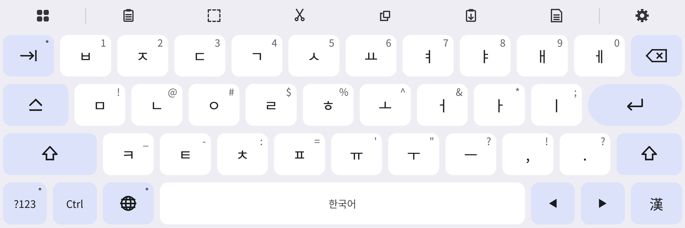
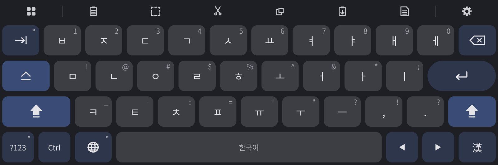
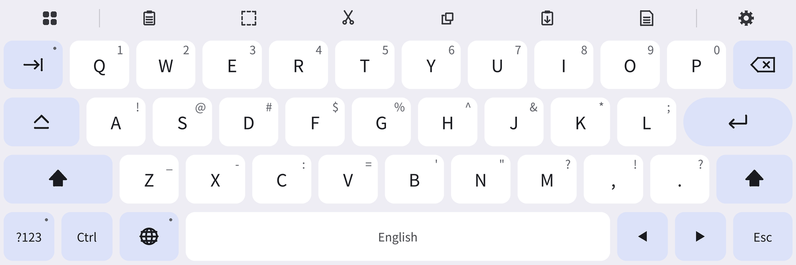
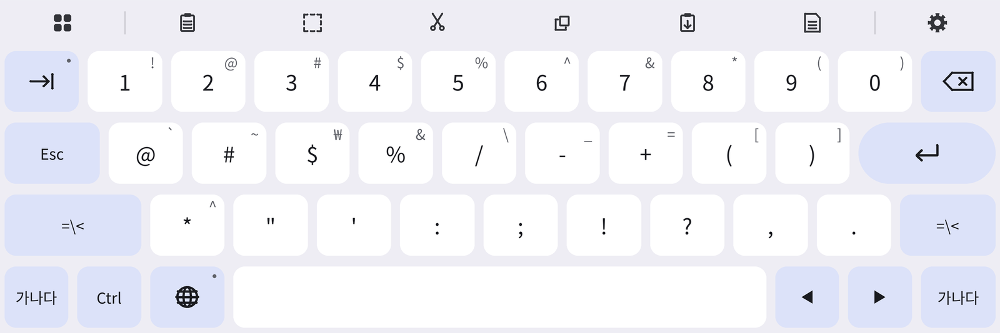

# ReteKey G for Lenovo Xiaoxin Pad Pro 13

샤오신패드 프로 13과 물리 키보드를 위한 Gboard 스타일 한글 키보드
 
A Gboard-style Korean keyboard for the Lenovo Xiaoxin Pad Pro 13 with a physical keyboard

[한국어](#한국어) · [English](#english) · [다운로드 · Download](https://github.com/Choo-AI-Dev/retekey-g-xiaoxin-pad-pro-13/releases)

<table>
  <tr>
    <td></td>
    <td></td>
  </tr>
  <tr>
    <td align="center">한글 · Korean</td>
    <td align="center">다크 모드 + Caps Lock · Dark mode + Caps Lock</td>
  </tr>
  <tr>
    <td></td>
    <td></td>
  </tr>
  <tr>
    <td align="center">영문 + Shift · English + Shift</td>
    <td align="center">기호 · Symbols</td>
  </tr>
</table>

미리보기 이미지입니다. 기기에 따라 글꼴과 간격이 조금 다를 수 있습니다. · Preview images; fonts and spacing may differ slightly on your device.

---

## 한국어

### 왜 만들었나

샤오신패드 프로 13에 물리 키보드를 연결해서 쓰는데, 키보드 앱마다 불편한 점이 하나씩 있었습니다.

1. **Gboard** — 물리 키보드용 한글 배열이 없어서 한/영 전환이 되지 않습니다.
2. **네이버 키보드** — 원격 데스크톱(원격 Windows)에 접속해서 쓸 때 입력 지연이 자주 생깁니다.
3. **ReteKey IME** — 위 두 문제는 없지만, 화면 키보드 디자인이 투박합니다.

그래서 ReteKey의 입력 엔진(한글 조합, 물리 키보드 한/영 전환, 원격·터미널 대응)은 그대로 두고, **화면 키보드만 Gboard처럼** 다시 만들었습니다.

### 주요 기능

- Gboard 색상(Android 12 이상은 배경화면 색 연동)과 다크 모드, 둥근 키, 알약 모양 Enter, 아이콘 툴바
- Gboard 태블릿 배열 (두벌식 · QWERTY), 숫자가 윗줄에 있는 기호 자판 2페이지
- 메뉴 페이지: 실행 취소, 클립보드, 메모장, 키보드 크기, 플로팅, 테마, 설정과 커서 이동·선택·복사/붙여넣기 키
- 한국어 설정 화면, 설정에서 원래 ReteKey 배열로 되돌리기 가능

### 사용법

1. 쓰던 키보드 앱(Gboard, 네이버 키보드 등)을 삭제합니다. 기본 앱이라 삭제가 안 되면 '사용 중지'합니다.
2. [Releases](https://github.com/Choo-AI-Dev/retekey-g-xiaoxin-pad-pro-13/releases)에서 `ReteKey-G-0.0.0-beta.apk`를 받아 설치합니다. (Android 9.0 이상, '출처를 알 수 없는 앱' 설치 허용)
3. 설정 → 시스템 → 키보드 → 화면 키보드에서 **ReteKey G**를 켜면 끝입니다.

### 베타 안내

- 실기기에서 테스트 중인 베타 버전입니다.
- 메모장·클립보드 창의 일부 버튼은 아직 영어로 표시됩니다.

---

## English

### Why I made this

I use a Lenovo Xiaoxin Pad Pro 13 with a physical keyboard, and every keyboard app I tried had one thing in the way.

1. **Gboard** has no Korean layout for physical keyboards, so switching between Korean and English does not work.
2. **Naver Keyboard** often lags when I type into a remote Windows desktop.
3. **ReteKey IME** solves both problems, but its on-screen keyboard looks dated.

So ReteKey G keeps ReteKey's input engine (Hangul composition, Korean/English switching on a physical keyboard, remote and terminal support) as it is, and rebuilds **only the on-screen keyboard to look and feel like Gboard**.

### Features

- Gboard colours (matched to your wallpaper on Android 12+), dark mode, rounded keys, pill-shaped Enter, icon toolbar
- Gboard tablet arrangement for 2-beolsik Korean and QWERTY; two symbol pages with digits on the top row
- Menu page: undo, clipboard, notepad, keyboard size, floating mode, theme, settings, plus cursor, selection and copy/paste keys
- Settings screens in Korean; you can switch back to the original ReteKey arrangement in settings

### How to use

1. Uninstall the keyboard app you use now (Gboard, Naver Keyboard, etc.). If it is a built-in app that cannot be uninstalled, disable it.
2. Download `ReteKey-G-0.0.0-beta.apk` from [Releases](https://github.com/Choo-AI-Dev/retekey-g-xiaoxin-pad-pro-13/releases) and install it (Android 9.0 or later; allow installs from unknown sources).
3. Turn on **ReteKey G** in Settings → System → Keyboard → On-screen keyboard, and you are done.

### Beta

- This is a beta that is still being tested on the device.
- A few buttons in the notepad and clipboard windows are still in English.

---

Based on [ReteKey IME](https://github.com/rubidus-api/retekey_apk) (MIT). See [LICENSE](LICENSE), [NOTICE](NOTICE) and [THIRD_PARTY_NOTICES.md](THIRD_PARTY_NOTICES.md).
